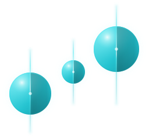

<a id="readme-top"></a>

[![Release][release-shield]][release-url]
[![License][license-shield]][license-url]
[![Stars][stars-shield]][stars-url]
[![Issues][issues-shield]][issues-url]

<br />
<div align="center">
  <a href="https://bankoti.dev/Orion/">
    
  </a>

<h3 align="center">Orion</h3>

  <p align="center">
    A fast, subscription-free RAW photo editor for macOS.
    <br />
    <a href="planning/STATUS.md"><strong>Read where it stands »</strong></a>
    <br />
    <br />
    <a href="https://bankoti.dev/Orion/download/">Download</a>
    &middot;
    <a href="https://github.com/Nano-AI/Orion/issues/new?labels=bug">Report a bug</a>
    &middot;
    <a href="https://github.com/Nano-AI/Orion/issues/new?labels=enhancement">Request a feature</a>
  </p>
</div>

<details>
  <summary>Table of Contents</summary>
  <ol>
    <li>
      <a href="#about-the-project">About the project</a>
      <ul>
        <li><a href="#built-with">Built with</a></li>
        <li><a href="#how-it-is-built">How it is built</a></li>
        <li><a href="#algorithms-are-cited-not-invented">Algorithms are cited, not invented</a></li>
      </ul>
    </li>
    <li>
      <a href="#getting-started">Getting started</a>
      <ul>
        <li><a href="#prerequisites">Prerequisites</a></li>
        <li><a href="#installation">Installation</a></li>
      </ul>
    </li>
    <li><a href="#usage">Usage</a></li>
    <li><a href="#tests">Tests</a></li>
    <li><a href="#roadmap">Roadmap</a></li>
    <li><a href="#contributing">Contributing</a></li>
    <li><a href="#license">License</a></li>
    <li><a href="#contact">Contact</a></li>
    <li><a href="#acknowledgments">Acknowledgments</a></li>
  </ol>
</details>

## About the project

[![Orion with a linear mask on a seascape][product-screenshot]](https://bankoti.dev/Orion/)

Adobe's grip on raw editing makes serious photo work expensive for students and
hobbyists. The open alternatives are capable but dated or hard to learn. Orion
aims at the gap: a GPU pipeline quick enough that adjustments feel instant, a
toolset capable of transforming an image rather than nudging it, and an
interface that stays out of the way of the photograph.

**Status: M0–M4 complete.** It browses a folder, culls, develops, crops, masks,
heals and exports with metadata and a color profile. The panel covers white
balance, tone, a tone curve, three-way color grading, an eight-band color mixer,
profiled noise reduction, lens corrections from a bundled 2,600-lens database,
sharpening, highlight recovery, clarity, dehaze, exposure fusion, creative LUTs,
film grain, a creative vignette, crop and straighten. Masks come in six kinds:
linear, radial, brush, subject matte, luminance range and colour range,
combined as a list and optionally feathered onto the photograph's own edges.
Undo is unlimited and edits persist per photo in XMP sidecars.

**Not there yet:** tethering, X-Trans sensors, and Windows and Linux builds.
The cross-platform interface (Avalonia) is on `main` beside the Swift app, and
the GPU backend it needs off the Mac (Dawn) passed its first spike. See
[`planning/STATUS.md`](planning/STATUS.md), which is the honest list, including
the one shipped defect: a 24 MP frame allocates more intermediate memory than an
8 GB Mac has, so it will not open there.

<p align="right">(<a href="#readme-top">back to top</a>)</p>

### Built with

* C++20 engine, Metal compute, shaders in [Slang](https://shader-slang.org/)
* SwiftUI and AppKit (the shipping app); [Avalonia](https://avaloniaui.net/) on .NET (the cross-platform interface)
* [LibRaw](https://www.libraw.org/) decode, [OpenColorIO](https://opencolorio.org/) and [lcms2](https://www.littlecms.com/) color
* [lensfun](https://lensfun.github.io/) lens data, SQLite index, XMP sidecars as the source of truth

### How it is built

A C++20 engine drives a Metal compute graph; a SwiftUI shell displays its output
texture directly, with no readback. Shaders are authored in Slang so a D3D or
WebGPU backend stays reachable.

Edits form a **DAG, not a chain**, so moving a slider recomputes only what sits
downstream of it. On an M4, a 24 MP Sony ARW re-renders an exposure change in
about 8 ms against a 16 ms budget, at full resolution, with no preview proxy.
That is why zooming to 100% shows real pixels: the full-resolution result is
already in a texture.

```
decode → linearize + white balance + white clip → RCD demosaic
       → highlight reconstruction → wavelet denoise (4 scales)
       → lens corrections → sharpen → camera matrix
       → guided filter → tone, color → three-way grade
       → AgX display transform + curve → crop, straighten, orientation
```

27 nodes, about 4 GiB of intermediates on a 24 MP frame.

Everything between the camera matrix and the display transform is scene-linear
and unbounded. There is exactly one display transform, and it is at the end.

The **white clip** in the first node is small and load-bearing. A sensor
saturates at one count for every channel, so a blown highlight arrives as
(S, S, S); white balance then multiplies each channel by its own gain and what
was a white light is, in ratio, the gains themselves. Nothing downstream can
undo that, because every stage after it preserves ratios. Without the clip,
every clipped light in a night frame renders magenta.

### Algorithms are cited, not invented

Every non-trivial filter cites a published reference in [`research/`](research/),
and anything that does not is listed honestly in
[`research/UNSOURCED.md`](research/UNSOURCED.md).

This rule exists because plausible-looking constants once shipped a purple cast
on every image, a class of bug that is invisible to inspection and obvious to
arithmetic. Citing the source makes the numbers checkable; testing the invariant
keeps them right.

Notable ports: RCD demosaic, the fast guided filter (He & Sun, arXiv:1505.00996)
for local highlight and shadow recovery, AgX (Sobotka) as the display transform,
monotone cubic Hermite (Fritsch & Carlson, 1980) for tone curves, à-trous
wavelet denoising (Starck et al., 2007) with a per-frame Poisson–Gaussian noise
fit (Foi et al., 2008), cross-channel highlight reconstruction (Masood, Zhu &
Tappen, CGF 2009), ASC CDL v1.2 for the grading wheels, and lensfun's lens
correction models.

No GPL code is copied. Implementing a *published algorithm* from its description
is fine, since mathematics is not copyrightable, and each entry says which it is.

<p align="right">(<a href="#readme-top">back to top</a>)</p>

## Getting started

To use Orion, download the newest alpha from
[bankoti.dev/Orion/download](https://bankoti.dev/Orion/download/): an Apple
silicon Mac on macOS 14 or later. To build it yourself, read on.

### Prerequisites

* macOS 14 or later, Xcode with the Metal toolchain, and [Homebrew](https://brew.sh/)
* The libraries:
  ```sh
  brew install cmake ninja libraw little-cms2
  ```
* Slang: extract a macOS release from
  [shader-slang/slang](https://github.com/shader-slang/slang/releases) into `third_party/slang/`

### Installation

1. Clone the repository
   ```sh
   git clone https://github.com/Nano-AI/Orion.git
   cd Orion
   ```
2. Configure and build
   ```sh
   cmake -S . -B build -G Ninja
   cmake --build build
   ```
3. Run it
   ```sh
   open build/Orion.app
   ```
4. Package a disk image a stranger can run: `tools/package-app.sh` for the Swift
   app, `tools/package-avalonia.sh` for the Avalonia one.

<p align="right">(<a href="#readme-top">back to top</a>)</p>

## Usage

### Opening a folder or photo from the shell

`Orion --open <folder|file>` opens a folder as the library, or a photo with its
parent folder as the library.
A convenient wrapper (this is the whole feature; see decision #193):

```sh
# ~/.zshrc - `orion` opens the cwd; `orion pic.ARW` opens that photo.
orion() {
  local app="$HOME/Documents/Orion/build/Orion.app"
  if [[ ! -d "$app" ]]; then
    echo "orion: $app not built" >&2
    return 1
  fi
  local -a paths
  local p
  for p in "${@:-$PWD}"; do paths+=("${p:A}"); done
  open -n -a "$app" --args --open "${paths[@]}"
}
```

Paths must be absolute: `open(1)` launches apps with cwd `/`, which is what
the `:A` modifier is for.
`-n` starts a new instance each time: `open -a` on a running app activates it
but drops `--args`, so the path would never arrive.

### Driving Orion from an agent

The agent surface is an MCP server over `Orion --agent`: it reads a photograph,
proposes an edit as a `.proposed.json` beside the RAW, and the editor shows it
for you to approve or reject.

`mcp/README.md` is the whole of it: the tools, what each one takes, and how a
proposal is approved. `.mcp.json` at the repo root wires it into Claude Code.

A packaged Orion.app carries the same server as `Contents/MacOS/orion-mcp`, a
Node single executable that needs no checkout and no Node, so a downloaded app
registers it with
`claude mcp add orion -- /Applications/Orion.app/Contents/MacOS/orion-mcp`
after clearing the download's quarantine (#310).

### The Avalonia interface

The cross-platform interface lives in [`shell/`](shell/);
its README has the build, the flags and the headless selftest.

<p align="right">(<a href="#readme-top">back to top</a>)</p>

## Tests

```sh
./build/apps/tests/orion-tests      # engine maths, plus real GPU renders
./build/orion-viewport-tests        # canvas geometry
./build/apps/bench/orion-bench file.ARW   # latency gate and per-control checks
./tools/check-agent.py              # the agent surface: a real render and a real approve
```

`CLAUDE.md` lists all nine gates to run before claiming anything works. The GPU
tests matter most: pure maths tests pass happily on code that renders garbage,
because they never touch a texture. Two shipped bugs proved it.

### The screenshot harness

```sh
./build/Orion.app/Contents/MacOS/Orion --screenshot out.png --photo x.ARW \
    --scene light [--measure x,y,w,h] [--size 1680x1050]
```

Renders the real view hierarchy offscreen, so no Screen Recording permission is
needed. `--measure` prints per-channel mean, standard deviation, saturation and
luma over a region of the engine's output, which is how "there is purple in my
photo" became a number that could be watched going down.

**What it cannot see:** the Metal canvas (AppKit cannot capture a Metal layer,
so it draws a still), and any 3D transform (`cacheDisplay` skips them). Both
limits are recorded in `planning/STATUS.md` rather than left to be rediscovered.

<p align="right">(<a href="#readme-top">back to top</a>)</p>

## Roadmap

- [x] M0–M4: library, culling, develop, crop, masks, healing, export
- [x] An MCP server so agents can propose edits for you to approve
- [x] The cross-platform interface (Avalonia) beside the Swift app
- [x] The Avalonia canvas fed from the GPU with no CPU copy
- [ ] Region-of-interest rendering: only what is on screen, at screen resolution
- [ ] Dawn as the GPU backend, for Windows and Linux builds
- [ ] X-Trans sensors
- [ ] Tethering

See [`planning/ROADMAP.md`](planning/ROADMAP.md) for the milestones and
[`planning/FEATURES.md`](planning/FEATURES.md) for every feature and its target.

<p align="right">(<a href="#readme-top">back to top</a>)</p>

## Contributing

Contributions are welcome. Read [`CONTRIBUTING.md`](.github/CONTRIBUTING.md)
and [`CLAUDE.md`](CLAUDE.md) first: its hard constraints (no GPL code, every
non-trivial filter cited in `research/`) apply to every change, and [`planning/DECISIONS.md`](planning/DECISIONS.md)
records the choices already settled.

1. Fork the project
2. Create a branch (`git checkout -b feature/your-change`)
3. Commit your changes (`git commit -m 'Add your change'`)
4. Push the branch (`git push origin feature/your-change`)
5. Open a pull request

Forks exist to send pull requests back; [`LICENSE`](LICENSE) forbids distributing your own version. By contributing you grant the project the rights its additional permissions describe.

### Top contributors

<a href="https://github.com/Nano-AI/Orion/graphs/contributors">
  
</a>

<p align="right">(<a href="#readme-top">back to top</a>)</p>

## License

**Source-available, not open source. See [`LICENSE`](LICENSE).**

[PolyForm Internal Use 1.0.0](https://polyformproject.org/licenses/internal-use/1.0.0), plus permission for personal use and pull requests. Use Orion for your own work or your company's, paid or not, and help improve it through pull requests. You may not redistribute it, in source or binary form, or sell it or your own version of it. Revisions through commit abf3a51, and commits 82ec298 and 4005930, were published under Apache-2.0 and remain available under it.

⚠ **[`NOTICE`](NOTICE) carries third-party licenses and obligations**:

| What | Terms |
|---|---|
| LibRaw | LGPL-2.1 / CDDL-1.0, linked dynamically |
| `data/lensfun/` | CC BY-SA 3.0: **share-alike binds the data**, so a corrected calibration goes back under the same licence |
| Adobe DNG | royalty-free patent grant, conditional on the notice appearing |
| `web/fonts/` | SIL OFL 1.1 |

⚠ **A licence is not a freedom-to-operate assessment, and none has been done.**
`CLAUDE.md` says this in as many words: a method can be published, dated,
correctly attributed and still be covered by a live patent. Every algorithm here
is implemented from a published description and cited in `research/`, and no
GPL source was read to write any of it, but nobody has searched the patent
literature.

<p align="right">(<a href="#readme-top">back to top</a>)</p>

## Contact

Orion: [alpha@bankoti.dev](mailto:alpha@bankoti.dev) · [bankoti.dev/Orion](https://bankoti.dev/Orion/)

Project: [github.com/Nano-AI/Orion](https://github.com/Nano-AI/Orion)

<p align="right">(<a href="#readme-top">back to top</a>)</p>

## Acknowledgments

* [LibRaw](https://www.libraw.org/), [lensfun](https://lensfun.github.io/), [OpenColorIO](https://opencolorio.org/) and [Little CMS](https://www.littlecms.com/)
* Troy Sobotka's [AgX](https://github.com/sobotka/AgX) display transform
* The papers cited in [`research/`](research/), which every filter is built from
* Planet maps on the website by [Solar System Scope](https://www.solarsystemscope.com/textures/), CC BY 4.0
* [Best-README-Template](https://github.com/othneildrew/Best-README-Template), which this README follows

<p align="right">(<a href="#readme-top">back to top</a>)</p>

[release-shield]: https://img.shields.io/github/v/release/Nano-AI/Orion?include_prereleases&style=for-the-badge
[release-url]: https://github.com/Nano-AI/Orion/releases
[license-shield]: https://img.shields.io/github/license/Nano-AI/Orion?style=for-the-badge
[license-url]: https://github.com/Nano-AI/Orion/blob/main/LICENSE
[stars-shield]: https://img.shields.io/github/stars/Nano-AI/Orion?style=for-the-badge
[stars-url]: https://github.com/Nano-AI/Orion/stargazers
[issues-shield]: https://img.shields.io/github/issues/Nano-AI/Orion?style=for-the-badge
[issues-url]: https://github.com/Nano-AI/Orion/issues
[product-screenshot]: web/img/orion-mask-1200.jpg
